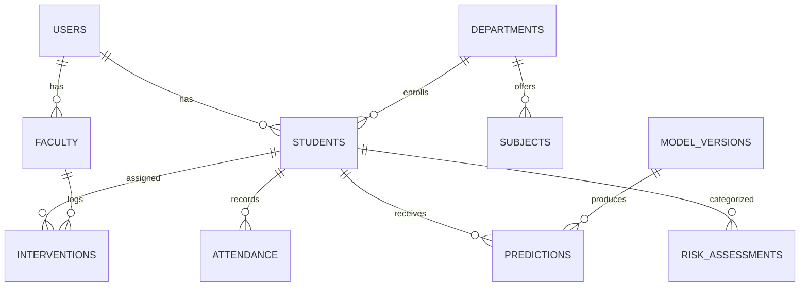

# 🎓 Trekverse AI Student Intelligence & Academic Early-Warning System

[](https://www.python.org/)
[](https://streamlit.io/)
[](https://scikit-learn.org/)
[](https://xgboost.readthedocs.io/)
[](https://shap.readthedocs.io/)
[](https://sqlite.org/)
[](tests/)

An end-to-end Machine Learning, Explainable AI, and Academic Management platform that predicts student academic performance, forecasts early risk categories, simulates academic What-If scenarios, and prescribes personalized learning strategies.

## 🚀 Live Demo & Repository

- **🌐 Live Application Deployment:** [Streamlit Cloud Demo](https://student-performance-ai-7l6i22jkhk5staxyhunven.streamlit.app/)
- **💻 Official GitHub Repository:** [https://github.com/Tharun-720/student-performance-ai](https://github.com/Tharun-720/student-performance-ai)

> **Decision Support Notice**: This application is a transparent **decision-support prototype** built to assist faculty mentoring and personalized student guidance. Statistical estimates support, and never replace, professional instructor judgment.

---

### 👨‍🎓 Project Credits & Institutional Profile

| Parameter | Details |
|---|---|
| **Author** | **Tharun** |
| **Roll Number** | **232G1A3249** |
| **Organization / Lab** | **Trekverse Edutech — Project Lead & AI Architect** |
| **College & Department** | **Trekverse AI Academy / Department of Computer Science & AI** |
| **Project Level** | **Advanced B.Tech Final-Year Capstone Project** |

---

## 📑 Table of Contents

- [🌟 Overview & Objectives](#-overview--objectives)
- [🚀 Key System Features](#-key-system-features)
- [📊 Model Evaluation & Benchmarks](#-model-evaluation--benchmarks)
- [🖼️ System Visualizations & Performance Gallery](#️-system-visualizations--performance-gallery)
- [🧠 Explainable AI with SHAP](#-explainable-ai-with-shap)
- [🎛️ AI What-If Simulator & Study Planner](#️-ai-what-if-simulator--study-planner)
- [🏛️ Relational Database Architecture](#️-relational-database-architecture)
- [📂 Project Directory Structure](#-project-directory-structure)
- [🛠️ Quickstart & Local Setup](#️-quickstart--local-setup)
- [📚 Comprehensive Project Documentation](#-comprehensive-project-documentation)
- [⚠️ Limitations & Responsible AI Guidelines](#️-limitations--responsible-ai-guidelines)

---

## 🌟 Overview & Objectives

Traditional academic remediation is often reactive—triggered only after examinations have concluded. The **Trekverse AI Student Intelligence System** addresses this challenge through proactive, interpretable, data-driven analytics:

1. **AI Early-Warning System**: Continuous risk tier classification into Low, Moderate, and High Risk categories with calibrated probabilities.
2. **Transparent Explainability (XAI)**: Demystifies predictions using mathematical SHAP values, identifying both positive drivers and critical vulnerabilities.
3. **Interactive Scenario Simulation**: What-If sandbox modeling how changes in study hours and attendance affect predicted outcomes.
4. **Curriculum-Level Forecasting**: Subject-wise marks prediction across Mathematics, Programming, DBMS, and Networks.
5. **Personalized Action Planning**: Automated generation of day-by-day weekly study timetables and tailored intervention logs.
6. **Conversational Assistant**: Context-aware natural language assistant answering student standing and revision queries.

---

## 🚀 Key System Features

| Feature Module | Description | Core Technology |
|---|---|---|
| ⚠️ **Early-Warning Engine** | Identifies students needing support with Low 🟢, Moderate 🟡, High 🔴 risk classification | Random Forest, XGBoost |
| 🎛️ **What-If Simulator** | Interactive sliders allowing students to simulate score changes by altering study habits | Real-time ML Inference |
| 📊 **Subject-Wise Forecasting** | Predicts marks separately for core curriculum courses (DBMS, Networks, Math, Coding) | Multi-Output Regression |
| 📅 **Personalized Study Planner** | Generates tailored 7-day revision timetables based on diagnosed concept gaps | Pedagogical Rules Engine |
| 🤖 **AI Academic Assistant** | Conversational agent answering queries on risk factors and revision roadmaps | Grounded NLP Query Engine |
| 📄 **Automated PDF/TXT Reports** | Standardized Trekverse Academic Intelligence Reports available for download | Automated Template Engine |
| 🏛️ **Database Persistence** | 16-table relational schema logging predictions, risk assessments, and interventions | SQLite / PostgreSQL |
| 👥 **Student Clustering** | Unsupervised K-Means discovering behavioral archetypes without target labels | Scikit-Learn K-Means |

---

## 📊 Model Evaluation & Benchmarks

Models were evaluated using **grouped 5-fold cross-validation on the training set** (836 records) and validated on a held-out test split (208 records). Records belonging to the same student never span training and test partitions.

<!-- RESULTS:START -->
| Task | Selected Model | Test Metric (Held-Out Split) | No-Learning Baseline |
|---|---|---|---|
| **Final Score (0–100%)** | **Gradient Boosting (Tuned)** | MAE **4.54**, RMSE **8.26**, R² **0.795** | "Final = G2": MAE 3.85, R² 0.802 |
| **Support Tier (3 classes)** | **Random Forest (Tuned)** | Accuracy **0.870**, Macro-F1 **0.871** | Tier from G2: Accuracy 0.861, Macro-F1 0.861 |

Evaluation split: 836 training and 208 test records; a student's records never appear on both sides. Models were selected by 5-fold grouped cross-validation on the training portion; the test split was used once. Without G1/G2 the same model family reaches only R² 0.21 (MAE 11.7).
<!-- RESULTS:END -->

---

## 🖼️ System Visualizations & Performance Gallery

The system generates publication-grade visualizations to provide transparency across exploratory analytics and model mechanics:

### 1. Model Validation & Residual Analysis
| Confusion Matrix (Classifier) | Residual Analysis (Regressor) |
|---|---|
|  |  |

### 2. Exploratory Analytics & Grade Trajectory
| Academic Grade Trajectory (G1 → G2 → G3) | Multi-Model Regression Benchmark |
|---|---|
|  |  |

### 3. Student Behavioral Clustering & Engagement Archetypes
| Correlation Heatmap | 2-D PCA Behavioral Clusters |
|---|---|
|  |  |

---

## 🧠 Explainable AI with SHAP

Rather than functioning as an opaque system, predictions are explained via **SHAP (Shapley Additive Explanations)**:
- **Global Feature Importance**: Quantifies curriculum-wide importance (G2, G1, absences, and attendance trends carry the highest signal).
- **Individual Student Attribution**: Computes point-by-point contributions that push a student's predicted score above or below the baseline average.
- **Fairness & Interpretability**: Distinguishes statistical correlation from causality, providing transparent evidence for faculty review.

---

## 🎛️ AI What-If Simulator & Study Planner

The application incorporates interactive modules designed to encourage student self-regulation:
- **What-If Analysis**: Move interactive sliders for daily study hours and attendance to observe model score projections in real time.
- **Adaptive Timetable**: Inputs your daily available hours (e.g. 2 hours/day) and synthesizes a Monday-to-Sunday schedule targeting your diagnosed weak subjects (e.g. DBMS revision on Monday, SQL practice on Tuesday, Mathematics derivations on Wednesday).

---

## 🏛️ Relational Database Architecture

The system is backed by a relational schema configured for institutional data management:



Database tables implemented in `database/schema.sql`:
1. `users`, `departments`, `faculty`, `students`, `subjects`
2. `attendance`, `assignments`, `internal_marks`, `semester_results`
3. `model_versions`, `predictions`, `risk_assessments`
4. `recommendations`, `study_plans`, `interventions`, `audit_logs`

---

## 📂 Project Directory Structure

```
student-performance-ai/
├── app/
│   └── main.py                     # Streamlit multi-role intelligence application
├── database/
│   ├── schema.sql                  # Complete 16-table relational schema
│   ├── database.py                 # SQLite persistence & intervention logging
│   └── student_intelligence.db     # Active database instance
├── data/
│   ├── raw/                        # UCI educational dataset records
│   └── processed/                  # Student-aware train/test splits (student_cleaned.csv)
├── docs/
│   ├── PROJECT_ENHANCEMENT_PROPOSAL.md # Complete 24-section upgrade specification
│   ├── PROJECT_PROPOSAL.md         # Problem definition & system roadmap
│   ├── FINAL_TECHNICAL_REPORT.md   # Mathematical evaluation & audit report
│   ├── MODEL_EVALUATION_REPORT.md  # Detailed cross-validation metrics
│   ├── EXPLAINABILITY_REPORT.md    # Global & local SHAP case studies
│   ├── VIVA_PREPARATION_GUIDE.md   # Capstone defense questions & answers
│   ├── DATA_DICTIONARY.md          # Variable schema & engineered features
│   └── images/                     # 9 publication-grade charts & diagrams
├── models/                         # Serialized models, scalers, and manifests
├── src/
│   ├── what_if_simulator.py        # Scenario simulation engine
│   ├── subject_analyzer.py         # Subject-wise marks forecasting
│   ├── study_planner.py            # Personalized 7-day study schedule generator
│   ├── academic_assistant.py       # Conversational AI assistant
│   ├── report_generator.py         # Standardized academic report generator
│   ├── predict.py                  # Single & batch inference service
│   ├── explainability.py           # SHAP & Permutation feature importance
│   ├── recommender.py              # Pedagogical recommendation rules
│   ├── train_models.py             # Grouped CV training & hyperparameter tuning
│   └── data_preprocessing.py      # Feature engineering & leakage prevention
├── tests/                          # Automated pytest suite (94 passed tests)
├── requirements.txt                # Pinned library dependencies
└── README.md
```

---

## 🛠️ Quickstart & Local Setup

### 1. Clone the Repository
```bash
git clone https://github.com/Tharun-720/student-performance-ai.git
cd student-performance-ai
```

### 2. Create and Activate Virtual Environment
```bash
# Windows (PowerShell)
python -m venv venv
.\venv\Scripts\Activate.ps1

# Linux / macOS
python3 -m venv venv
source venv/bin/activate
```

### 3. Install Dependencies
```bash
pip install -r requirements.txt
```

### 4. Run the Streamlit Application
```bash
streamlit run app/main.py
```
Open your browser and navigate to **`http://localhost:8501`**.

### 5. Run the Test Suite
```bash
pytest tests
```
*All 94 automated unit and integration tests should pass with 0 errors.*

---

## 📚 Comprehensive Project Documentation

Explore the detailed technical documentation included with this project:

- 📋 [**PROJECT_ENHANCEMENT_PROPOSAL.md**](docs/PROJECT_ENHANCEMENT_PROPOSAL.md) — Comprehensive 24-section AI/ML project upgrade proposal.
- 🎯 [**PROJECT_PROPOSAL.md**](docs/PROJECT_PROPOSAL.md) — Problem statement, stakeholder analysis, and system objectives.
- 🔬 [**FINAL_TECHNICAL_REPORT.md**](docs/FINAL_TECHNICAL_REPORT.md) — Complete methodology, preprocessing, and model audits.
- 📈 [**MODEL_EVALUATION_REPORT.md**](docs/MODEL_EVALUATION_REPORT.md) — Metrics across all evaluated regression and classification models.
- 🔍 [**EXPLAINABILITY_REPORT.md**](docs/EXPLAINABILITY_REPORT.md) — Mathematical SHAP attribution, base values, and case studies.
- 🎓 [**VIVA_PREPARATION_GUIDE.md**](docs/VIVA_PREPARATION_GUIDE.md) — Defense guide covering technical viva questions and examiner responses.
- 📖 [**DATA_DICTIONARY.md**](docs/DATA_DICTIONARY.md) — Comprehensive schema definition for raw and engineered variables.

---

## ⚠️ Limitations & Responsible AI Guidelines

1. **Grade Continuation Dynamic**: Second-period grade (G2) carries the strongest predictive signal. The heuristic "final = G2" is competitive with trained models.
2. **Absence Records**: Absences are counts rather than verified percentage attendance records.
3. **Historical Data Setting**: Derived from the public UCI Student Performance dataset (Portuguese secondary schools); patterns may vary across different university environments.
4. **Advisory Purpose**: Model inferences are statistical estimates designed to inform academic mentoring, not automated determinations.

---

## 📄 License & Attribution

- **Dataset**: Cortez and Silva, *Using Data Mining to Predict Secondary School Student Performance*, 2008 (UCI Machine Learning Repository, CC BY 4.0).
- **Platform Development**: Developed by **Tharun (232G1A3249)**, Trekverse Edutech / Trekverse AI Academy.
