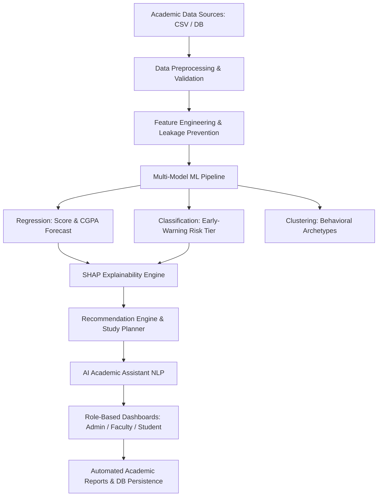

# Project Enhancement Proposal: AI-Powered Student Academic Management & Early-Warning System

**Project Title**: Trekverse AI Student Intelligence & Academic Early-Warning System  
**Author**: Tharun · **Roll no.**: 232G1A3249 · **College**: Trekverse AI Academy · **Guide**: Project Faculty Guide  
**Organization / Role**: Trekverse Edutech — Project Lead & AI Architect  
**Project Level**: Advanced B.Tech Final-Year Capstone Project  

---

## Executive Summary

The objective of this enhancement is to transform the foundational academic performance prediction prototype into a comprehensive, multi-role **AI-Powered Intelligent Student Academic Management & Early-Warning System**. By integrating advanced Machine Learning, Explainable AI (SHAP), Natural Language Processing, personalized recommendation engines, and database persistence, the platform empowers students, faculty mentors, and academic administrators with actionable, transparent, data-driven academic intelligence.

---

## Current Project vs. Recommended AI/ML Modifications

| Current Implementation | Recommended AI/ML Modification |
|---|---|
| Basic academic performance prediction | AI-powered academic performance and risk prediction |
| Single Machine Learning model | Compare Random Forest, XGBoost, LightGBM, CatBoost, and suitable baselines |
| Manual student data entry | Automated data ingestion and intelligent data validation |
| Static prediction results | Real-time predictions with continuously updated student information |
| Basic statistical analysis | AI-powered academic analytics and pattern discovery |
| Rule-based recommendations | ML-driven personalized learning recommendations |
| No explainability | Explainable AI using SHAP and feature importance |
| Basic student classification | ML-based student risk classification |
| No student segmentation | K-Means and hierarchical clustering for student behavior analysis |
| Fixed study suggestions | AI-powered personalized study planner |
| Traditional dashboard | Interactive AI-powered academic intelligence dashboard |
| Manual performance evaluation | Automated performance assessment and anomaly detection |
| No future performance analysis | Semester-wise and subject-wise performance forecasting |
| Static reports | AI-generated student performance reports |
| No conversational interface | AI academic assistant using Natural Language Processing |
| Manual intervention decisions | AI-assisted faculty intervention recommendations |
| No model monitoring | Model performance monitoring and drift detection |
| CSV-based data storage | Database-backed academic management system |
| Basic user interface | Modern, role-based education platform |

---

## Detailed Enhancement Specifications

### 1. Add an AI-Powered Early-Warning System
Develop an intelligent system that uses Machine Learning to identify students who may be at risk of poor academic performance. Instead of relying solely on static thresholds, the system analyzes multi-dimensional academic records to detect risk signals early.

**Student Risk Categories**:
- 🟢 **Low Risk**: Student is performing satisfactorily and on track for academic milestones.
- 🟡 **Moderate Risk**: Student exhibits early vulnerabilities and may need targeted academic support.
- 🔴 **High Risk**: Student demonstrates severe performance deficit requiring timely faculty intervention.

**Machine Learning Inputs Analyzed**:
- Attendance percentage and absence patterns
- Previous semester CGPA and academic history
- Internal examination marks (G1, G2)
- Assignment submission and completion rate
- Quiz averages and study hours per day
- Previous academic backlogs / failures
- Subject-wise trends and engagement consistency

**Recommended Algorithms**: Random Forest Classifier, XGBoost Classifier, LightGBM Classifier, Logistic Regression, Support Vector Machine.  
*Validation Note*: The final algorithm is selected based on cross-validation, class balance, calibration, and the cost of missed warnings. Risk probabilities are calibrated and presented as decision-support indicators alongside faculty judgment.

**Example Cohort Distribution** (Illustrative):
- Total Students: 295
- Low-Risk Students: 214 (72.5%)
- Moderate-Risk Students: 57 (19.3%)
- High-Risk Students: 24 (8.1%)

---

### 2. Add AI-Based Academic Performance Prediction
Upgrade the prediction module from single-point final grade estimation to multi-horizon academic forecasting:
1. Final examination score prediction (0–100% continuous and 0–20 scale)
2. Semester performance and CGPA projection
3. Subject-wise marks prediction across curriculum modules
4. Academic improvement estimation over time
5. Prediction intervals capturing model uncertainty (e.g., cross-validated residual intervals)

**Recommended Models Evaluated**: Linear / Ridge Regression, Decision Trees, Random Forest Regressor, Gradient Boosting Regressor, XGBoost Regressor, LightGBM Regressor.

---

### 3. Implement Explainable AI Using SHAP
A prediction alone does not explain why an outcome is expected. Integrating SHAP (Shapley Additive Explanations) ensures transparent mathematical justification:
- **Global Feature Importance**: Identifies overall curriculum signals driving cohort outcomes.
- **Local Student Explanations**: Computes exact positive (protective) and negative (risk-inducing) contributions in points for every individual prediction.
- **Visualizations**: Mean |SHAP| summary plots, permutation importance benchmarks, and individual horizontal contribution bar charts.
- *Responsible XAI Principle*: Explanations reflect model dependencies and statistical patterns, not unverified causal assertions.

---

### 4. Add an AI-Based What-If Simulator
An interactive simulation engine allowing students and mentors to test alternative academic scenarios:
- **Interactive Sliders**: Adjust attendance rate, daily study hours, assignment completion, and interim scores.
- **Real-Time Inference**: Instant re-computation of predicted score, support tier, and risk level.
- **Comparative Analysis**: Before-and-after side-by-side comparison tables highlighting expected changes.
- *Educational Value*: Demonstrates actionable pathways to grade recovery and encourages self-regulated learning habits.

---

### 5. Develop an AI-Powered Student Dashboard
A dedicated student-centric interface combining:
- Student Profile & Academic Trajectory (G1 → G2 → Predicted Final)
- Attendance Analytics & Absence Thresholds
- Subject-Wise Marks & Weak Subject Alerts
- AI-Predicted Performance & Calibrated Risk Assessment
- SHAP Feature Contributions & Gap Diagnosis
- Personalized Weekly Study Planner & Learning Resources
- What-If Simulation Sandbox

---

### 6. Develop an AI-Powered Faculty Dashboard
A command center for educators to monitor cohort health and deploy interventions:
- Class-Wide Analytics (Total Students, Mean CGPA, Mean Attendance)
- Risk Distribution Matrix (Low, Moderate, High Risk counts and student rosters)
- Vulnerability Prioritization: Identifies students requiring immediate 1-on-1 counseling
- Faculty Intervention Logging (Record mentoring notes, remedial actions, and follow-up schedules)
- Batch Student Scoring and Exportable Cohort Reports

---

### 7. Implement Subject-Wise Prediction and Analysis
Extend prediction beyond aggregate scores to individual curriculum subjects:
- Forecast scores separately across Mathematics, Programming, Database Management Systems (DBMS), Computer Networks, and Electronics.
- Automated weak subject diagnosis (e.g., flagging DBMS < 14/20 as *Needs Attention* while Programming 17/20 is *Strong*).
- Cross-subject correlation and difficulty pattern analysis to tailor tutoring resources.

---

### 8. Upgrade the Machine Learning Pipeline
Establish an end-to-end, reproducible ML workflow:
- **Data Validation & Cleaning**: Schema verification, absence outlier capping, and zero-leakage preprocessors.
- **Feature Engineering**: Ratio of study-time to free-time, assessment trajectory delta, and engagement indices.
- **Leakage Prevention**: Student-aware grouped cross-validation ensuring records from the same student never bridge training and validation folds.
- **Rigorous Evaluation**: MAE, RMSE, R² for regression; Accuracy, Precision, Recall, Macro-F1, and ROC-AUC for classification.

---

### 9. Add Deep Learning for Academic Performance Analysis
Incorporate Deep Learning as an advanced comparative experimental module:
- **Architectures**: Multi-Layer Perceptrons (MLP) / Artificial Neural Networks (ANN) for tabular academic feature representations.
- **Sequence Modeling**: Recurrent Neural Networks (LSTM) for multi-semester CGPA trajectory and attendance trends.
- **Empirical Rigor**: Deep learning models must be benchmarked directly against gradient-boosted trees on held-out validation splits to verify whether additional architectural complexity yields statistically significant improvements.

---

### 10. Add AI-Powered Dataset Upload and Validation
Empower institutions to upload new academic datasets (CSV / Excel):
- Automatic column mapping and schema verification
- Missing value and duplicate entry detection
- Outlier screening and distribution shift alerts
- Data preview and instant batch scoring

---

### 11. Add an AI-Powered Database Architecture
Transition from static flat files to a persistent relational database architecture:
- **Integrated Tables**: `users`, `departments`, `faculty`, `students`, `subjects`, `attendance`, `assignments`, `internal_marks`, `semester_results`, `predictions`, `risk_assessments`, `recommendations`, `study_plans`, `interventions`, `model_versions`, `audit_logs`.
- **Database Engine**: SQLite for development and PostgreSQL / MySQL for scalable institutional deployments.

---

### 12. Implement AI-Based Student Segmentation
Unsupervised clustering (K-Means with silhouette and centroid analysis) to discover behavioral archetypes without target labels:
- Cluster profiles characterizing study habits, attendance consistency, and social engagement.
- Centroid z-score interpretation to match academic guidance with student behavioral archetypes.

---

### 13. Develop an AI-Powered Personalized Study Planner
An adaptive recommendation engine that generates personalized study schedules:
- Day-by-day timetable (Monday through Sunday) targeting diagnosed weak subjects.
- Time allocation adjusted to student's available daily hours (e.g., 2–4 hours/day).
- Balanced distribution between concept revision, problem practice, and weekly self-assessment.

---

### 14. Add a Generative AI Academic Assistant
A conversational assistant interface powered by NLP:
- Supports natural queries from students (*"Why is my risk classified as moderate?"*, *"Which subjects need the most attention?"*, *"Create a study plan"*) and faculty (*"Which students need intervention?"*, *"Summarize class performance"*).
- Grounded strictly in validated student predictions, SHAP feature weights, and institution records to eliminate hallucination.

---

### 15. Add an AI-Based Academic Recommendation Engine
Combines predictive outputs, SHAP explanations, and pedagogical rules into prioritized action cards:
- Severity ratings (Critical, High, Medium, Low, Info)
- Specific diagnosed causes paired with concrete remedial steps and learning resources
- Tracking of intervention acknowledgement and subsequent student follow-through

---

### 16. Add Automated AI-Powered Reports
Generate standardized, professional academic intelligence reports:
- **Trekverse AI Academy Standard Template**:
  1. Student Information
  2. Academic Performance & Trajectory
  3. AI/ML Predictive Analysis & Risk Category
  4. Personalized Recommendations & Faculty Interventions
  5. Progress Tracking & Analytical Disclaimers
- Formatted for instant on-screen review and downloadable as formatted documents.

---

### 17. Improve the UI with an AI Intelligence Dashboard
Transform the web interface into an education analytics platform:
- Professional styling with clean typography and custom KPI metric cards
- Seamless role-based navigation (Admin, Faculty, Student)
- High-contrast interactive Plotly charts, risk badges, and comparative data tables

---

### 18. Add Role-Based Authentication and Security
Implement structured access control:
- **Admin**: System configuration, model versioning, institutional dataset management, and audit logs.
- **Faculty**: Assigned student rosters, risk monitoring, prediction reviews, and intervention recording.
- **Student**: Personal academic profile, predictive scores, study planner, and What-If simulator.

---

### 19. Add AI Model Monitoring and Continuous Improvement
Monitor model reliability in post-deployment operations:
- Residual tracking and prediction error distribution
- Data drift detection across incoming cohorts
- Model artifact versioning with metadata manifests
- Retraining triggers when performance drops below threshold

---

### 20. Complete System Architecture



---

### 21. Recommended Project Structure

```
Trekverse-AI-Student-Intelligence/
├── app/
│   └── main.py                     # Streamlit multi-role intelligence application
├── backend/
│   ├── api.py                      # FastAPI REST endpoints
│   └── services/                   # Prediction, recommendation, and assistant services
├── database/
│   ├── schema.sql                  # Complete relational schema (16 tables)
│   └── database.py                 # SQLite persistence and audit logging
├── data/
│   ├── raw/                        # Original academic datasets
│   └── processed/                  # Cleaned, student-aware train/test splits
├── docs/
│   ├── PROJECT_PROPOSAL.md         # Foundational proposal
│   ├── PROJECT_ENHANCEMENT_PROPOSAL.md # Comprehensive upgrade specification
│   ├── FINAL_TECHNICAL_REPORT.md   # Mathematical and evaluation report
│   └── DATA_DICTIONARY.md          # Variable definitions and schemas
├── models/                         # Serialized models, scalers, and manifest
├── src/
│   ├── academic_assistant.py       # Conversational AI assistant
│   ├── what_if_simulator.py        # Scenario simulation engine
│   ├── subject_analyzer.py         # Subject-wise marks forecasting
│   ├── study_planner.py            # Personalized study schedule engine
│   ├── report_generator.py         # Standardized academic report generator
│   ├── explainability.py           # SHAP and permutation importance
│   ├── predict.py                  # Single and batch inference service
│   ├── recommender.py              # Pedagogical recommendation rules
│   └── train_models.py             # Grouped CV training and tuning
├── tests/                          # Automated pytest suite (88+ tests)
├── requirements.txt
└── README.md
```

---

### 22. Recommended Technology Stack

| Component | Recommended Technology |
|---|---|
| Programming Language | Python 3.10+ |
| Data Processing | Pandas, NumPy |
| Visualization | Plotly, Matplotlib, Seaborn |
| Machine Learning | Scikit-learn, XGBoost, LightGBM, CatBoost |
| Deep Learning | PyTorch / TensorFlow (MLP & LSTM experimentation) |
| Explainable AI | SHAP (TreeExplainer), Permutation Importance |
| Database | SQLite / PostgreSQL |
| Web Application | Streamlit (Interactive platform) |
| Report Generation | ReportLab / Markdown Template Engine |
| Automated Testing | Pytest |

---

### 23. Implementation Phases & Roadmap

| Phase | Milestone | Priority |
|---|---|---|
| Phase 1 | Data ingestion, validation, and exploratory data analysis | Essential |
| Phase 2 | ML model training, grouped cross-validation, and baseline comparison | Essential |
| Phase 3 | Academic score forecasting and calibrated risk classification | Essential |
| Phase 4 | SHAP explainability and feature contribution analysis | Essential |
| Phase 5 | Student and Faculty role-based dashboards | Essential |
| Phase 6 | Database schema implementation and persistent logging | High |
| Phase 7 | Interactive What-If academic simulator | High |
| Phase 8 | Personalized study planner and recommendation engine | High |
| Phase 9 | Automated academic intelligence report generation | High |
| Phase 10 | Unsupervised student segmentation and cluster profiling | Advanced |
| Phase 11 | Conversational AI academic assistant | Advanced |
| Phase 12 | Deep learning neural network experimentation | Advanced |
| Phase 13 | Model monitoring, drift detection, and continuous improvement | Advanced |

---

### 24. Best Overall Upgrade Summary

The upgraded **Trekverse AI Student Intelligence & Academic Early-Warning System** transitions the project from a basic predictive script into a smart, fair, and transparent education intelligence platform. By uniting rigorous machine learning, mathematical explainability, role-based workflows, interactive scenario simulation, personalized pedagogical planning, and persistent database storage, the system establishes a benchmark for academic decision-support prototypes.
